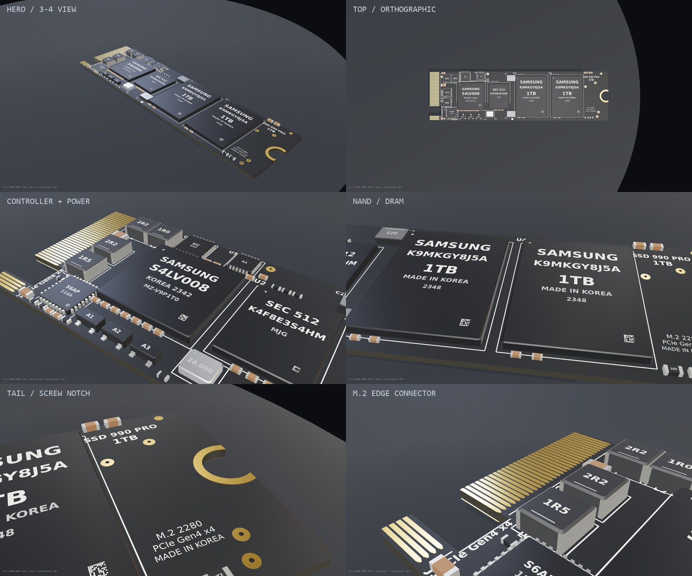

# M.2 2280 NVMe SSD — bare PCB, procedural OBJ

A detailed, colored, **sticker-free** M.2 2280 NVMe SSD model built entirely from
procedural geometry. The board is split into **90 named objects** so it can be
disassembled, exploded, or animated in Blender.



## Files

| Path | Description |
|---|---|
| `model/m2_ssd_2280.obj` | Main model (Wavefront OBJ), ~4.7 MB; 34,126 verts / 49,511 faces |
| `model/m2_ssd_2280.mtl` | Material library (24 materials) |
| `build_model.py` | Generator: PCB, packages, passives, text, OBJ/MTL export |
| `render.html` | Three.js preview scene (OBJ + MTL, studio lighting) |
| `render.js` | Headless Edge screenshot harness |
| `renders/` | Preview renders and contact sheet |

## Dimensions and coordinate system

* **1 OBJ unit = 1 mm**
* PCB: **80.0 × 22.0 × 0.8 mm** (2280 form factor)
* Coordinate frame:
  * **X** = board length, `0 … 80` (connector at `X=0`, screw end at `X=80`)
  * **Y** = thickness / up, `-0.8 … +0.8` (top side at `+Y`)
  * **Z** = board width, `-11 … +11`
* M.2 **M-key notch**: `X < 5.2`, `Z = 4.4 … 8.6` (5.2 × 4.2 mm cutout)
* Screw半孔: center `(79, 0)`, radius `2.12 mm`; gold keep-out ring outer radius
  `2.87 mm`
* Edge contacts: 0.48 mm pitch, 0.335 mm pad width, 4.36 mm length, on both
  top and bottom; the M-key slots are skipped.

## What is modeled

### Board and connector
- `PCB` — 0.8 mm board with rounded corners, M-key notch, screw half-hole,
  black solder mask and dark edge material.
- `J1_Contacts_Top`, `J1_Contacts_Bottom` — gold edge fingers on both sides.
- `ScrewPad_Top`, `ScrewPad_Bottom` — gold screw keep-out ring.

### Main ICs (package + separate marking object)
- `U1_Controller` + `U1_Marking` — 12 × 12 × 0.92 mm controller,
  “SAMSUNG / S4LV008 / KOREA 2342 / MZ-V9P1T0”, datamatrix and pin-1 dot.
- `U2_DRAM` + `U2_Marking` — 9 × 11 × 0.82 mm DRAM,
  “SEC 512 / K4F8E3S4HM / MJG”.
- `U3_NAND1`, `U4_NAND2` + markings — 14 × 18 × 1.02 mm NAND packages,
  “SAMSUNG / K9MKGY8J5A / 1TB / MADE IN KOREA / 2348”.

### Power, clock and small parts
- `U5_PMIC`, `U6_PowerStage`, `U7_Driver` — QFN packages with pin rows.
- `L1`–`L4` — shielded power inductors with `2R2`, `1R0`, `2R2`, `1R5` markings.
- `C1`, `C2` — polymer capacitors with `220` markings.
- `Q1`–`Q3` — SOT-23 transistors with `A1`, `A2`, `A3` markings.
- `Y1` — crystal with `24.000` marking.
- `C3`–`C28` — 0402/0603/0805 MLCCs.
- `R1`–`R14` — 0402/0603 resistors; `R13`/`R14` have `103`/`472` markings.
- `TP2`–`TP6` — gold test points.
- `FID1`–`FID3` — gold fiducials.
- `Silkscreen_Top`, `Silkscreen_Bottom` — separate top/bottom silkscreen
  geometry (component outlines, reference designators, logos, regulatory text).

All chip markings and silkscreen text are **extruded geometry**, not textures,
so they remain crisp at any zoom and survive OBJ export.

## Importing into Blender

1. `File > Import > Wavefront (.obj)`.
2. Select `model/m2_ssd_2280.obj`; the `.mtl` is found automatically.
3. Keep **Split by Object** enabled. Each `o …` entry becomes a separate
   Blender object; `U1_Controller`, `U1_Marking`, `Silkscreen_Top`, etc. can be
   moved or hidden independently.
4. With the default Y-up OBJ import, the board lies flat in Blender’s XY plane:
   length along X, width along Y, thickness along Z. Scale = 1.0.

For a quick exploded view, select components by prefix (`U`, `L`, `C`, `R`,
`TP`, `FID`) and move them along Blender Z. The PCB, gold fingers, screw ring,
and silkscreen are separate objects too.

## Materials

The MTL uses standard `Kd / Ka / Ks / Ns / Ni / d / illum` entries. Material
names are descriptive and stable:

`PCB_Black`, `PCB_Edge`, `Gold`, `Gold_Dark`, `Copper`, `Solder`,
`Chip_Black`, `Chip_Dark`, `Chip_Edge`, `QFN_Body`, `Inductor_Body`,
`Inductor_Top`, `Cap_Body`, `Cap_Terminal`, `Res_Body`, `Res_Terminal`,
`Polymer_Body`, `Polymer_Top`, `Crystal_Metal`, `Silkscreen`,
`Marking_White`, `Marking_Gray`, `PCB_Dark`, `Black_Plastic`.

The Three.js preview remaps these to PBR values (metalness/roughness) for a
more realistic look. In Blender, the imported MTL colors are a good starting
point; for close-ups, set gold/copper/solder materials to metallic and the
solder mask/chips to low metallic.

## Rebuilding / re-rendering

```bash
# Python 3.10+; requires numpy, shapely, trimesh, matplotlib, Pillow
python build_model.py

# Node 18+; requires three and puppeteer-core
npm install three@0.160.0 puppeteer-core@23.11.1
node render.js hero top controller nand tail connector bottom
```

The render harness starts a local HTTP server on port 8123, launches headless
Microsoft Edge with SwiftShader, and writes `renders/ssd_<view>.png`. The final
geometry was checked in this harness for material assignment, text holes, and
component/text placement.

## Notes / limitations

- This is a **bare PCB** model: no label sticker, no heatsink, no thermal pad.
- It is a **single-sided** board (components on top only), which is common for
  modern 2280 NVMe drives; the bottom has silkscreen and gold contacts.
- Package sizes, passives and text are representative rather than a
  manufacturing-accurate reproduction of a specific Samsung 990 PRO PCB.
- Text is geometry, so it adds vertices; the model is intentionally detailed
  rather than game-optimized.
- Copper traces, solder paste, vias and board fiberglass texture are not
  modeled; the focus is the visible component/PCB silhouette and markings.
