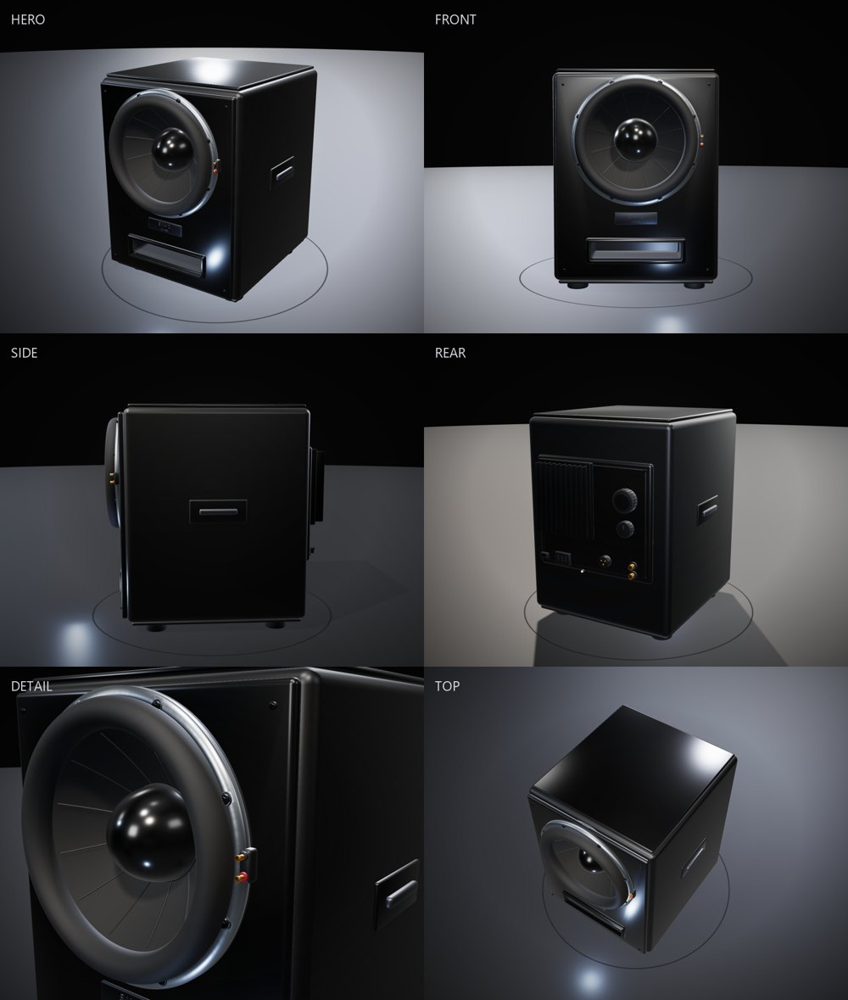

# SW-12 Vented Subwoofer — OBJ Model

A procedurally generated, texture-free 12-inch vented subwoofer in OBJ + MTL format.
The model is built with Blender Python and rendered for inspection with Three.js in
headless Microsoft Edge.



## Model overview

| Item | Value |
|---|---|
| Enclosure | Rounded MDF cabinet with raised baffle, top cap, plinth and rubber feet |
| Dimensions | 540 mm W × 680 mm H × 580 mm D (cabinet body) |
| Driver | 12-inch cast-frame subwoofer, front-mounted in a recessed well |
| Alignment | Vented / bass-reflex, slot port with duct and front trim |
| Amplifier | Rear plate amp: heatsink, volume/crossover knobs, RCA + XLR + IEC, power switch, LED |
| Extras | Side grip handles, front badge, mounting screws, tinsel leads, spider, voice coil, magnet assembly |
| Textures | None. Materials only. |

### Driver detail

- Cast aluminum flange with 8 mounting holes and black screws
- Thick rubber surround and coated paper cone with 12 radial ribs
- Gloss dust cap
- Corrugated spider, copper voice-coil turns, Kapton former
- 8 curved basket spokes with dark metal inlays
- Magnet assembly, terminal pod, red/black terminals, tinsel leads

## Files

| File | Description |
|---|---|
| `subwoofer_SW12.obj` | Main mesh. 125,658 vertices, 180,417 faces, 450 groups. |
| `subwoofer_SW12.mtl` | 21 materials with PBR `Pr`/`Pm` values plus derived Phong `Ks`/`Ns` for compatibility. |
| `generate_subwoofer.py` | Blender 4.4+ procedural generator. |
| `polish_mtl.py` | Post-processes the exported MTL so legacy Phong viewers do not turn matte dielectrics into chrome. |
| `viewer.html` | Three.js inspection viewer (OrbitControls, studio lighting, camera presets). |
| `capture.js` | Headless Edge screenshot script. |
| `renders/` | Rendered inspection views and contact sheet. |

## Coordinate system and units

- Units: meters.
- Up axis: **+Y**.
- Front of the cabinet: **+Z**.
- The driver axis is horizontal, pointing toward **+Z**.
- The OBJ was exported from Blender with `forward_axis='NEGATIVE_Z'`, `up_axis='Y'`.

## Regenerate the model

Requires Blender 4.4 or newer.

```bash
blender -b --python generate_subwoofer.py
python polish_mtl.py
```

The generator is deterministic and rebuilds the cabinet, port, driver, hardware and
rear amplifier from scratch. It prints object/vertex/triangle statistics and writes
`subwoofer_SW12.obj` + `subwoofer_SW12.mtl` next to the script.

> Note: the script looks up the Principled BSDF node by type rather than by the
> localized UI name, so it works with non-English Blender installations.

## View / render

The viewer loads the OBJ and MTL over HTTP. From this directory:

```bash
python -m http.server 8765
```

Then open:

```text
http://127.0.0.1:8765/viewer.html
```

Camera presets are available with `?view=hero|front|side|rear|detail|top`, e.g.
`viewer.html?view=detail`. Add `?screenshot=1` to hide the HUD.

To recapture all views with headless Edge:

```bash
node capture.js
```

The viewer parses the MTL's `Pr`/`Pm` values and builds `MeshStandardMaterial`
instances, so the authored roughness/metalness are respected instead of relying on
the legacy Phong fields.

## Notes on the build

- The cabinet is a rounded box with boolean-cut driver and port openings.
- The driver is modeled at the origin with its front toward −Y, then translated to
  `(0, −0.311, 0.12)` in Blender.
- The recess well is revolved around the world Y axis and then offset by `z = 0.12`
  to match the driver bore. This prevents the well wall from crossing the cone.
- The port is a hollow duct with a front frame, back wall and lip.
- No textures or image maps are used. All surface variation comes from geometry and
  material parameters.
