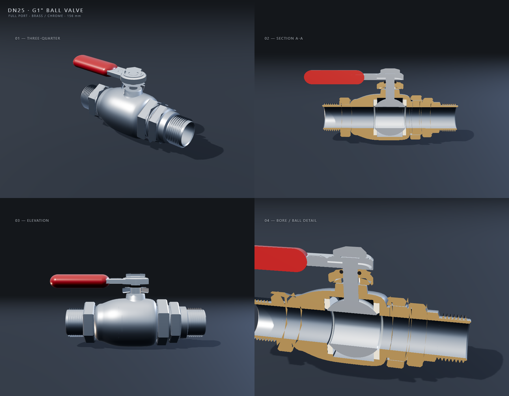
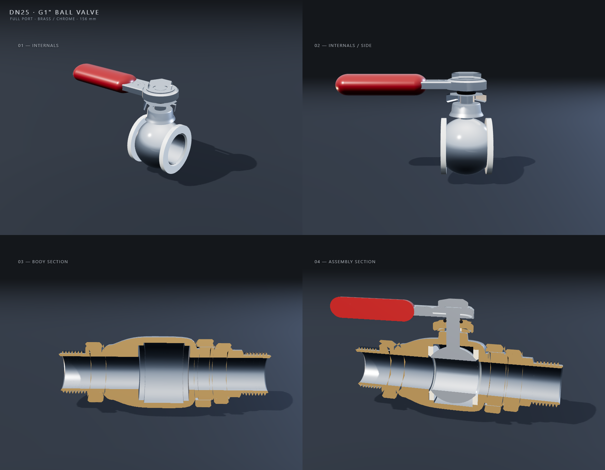
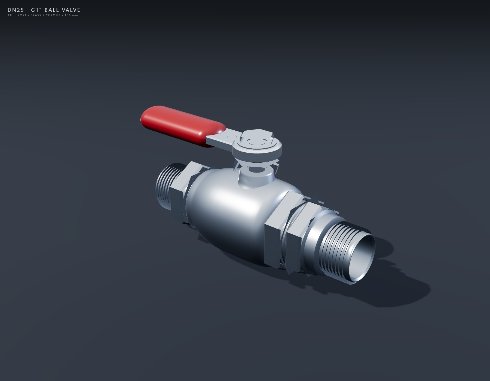

# DN25 / G1" 全通径黄铜镀铬球阀（OBJ）

程序化生成的 **DN25（G1"）全通径黄铜镀铬球阀** 零件模型，可直接用于渲染、装配示意、3D 打印前的形体检查或作为建模参考。模型为纯几何体，无贴图；包含阀体、端盖、螺纹、六角扳手位、活接螺母、球体、PTFE 阀座、阀杆、阀颈、填料压盖、O 型圈、手柄及手柄紧固件，共 **19 个独立对象**、**5 种材质**。







---

## 文件清单

| 文件 | 说明 |
|---|---|
| `valve.obj` | 主模型，Wavefront OBJ，单位 **mm**；77,958 顶点 / 86,084 三角面；约 8.4 MB（8.0 MiB） |
| `valve.mtl` | 材质库（ChromeSatin / ChromeBright / PTFE / RedEnamel / Rubber） |
| `gen_valve.py` | 参数化生成脚本；重新运行可得到完全一致的 OBJ/MTL |
| `render.html` | Three.js 实时查看器；支持默认四视图、`?mode=hero`、`?mode=inspect` |
| `shoot.js` | 使用 Playwright + 无头 Edge 自动截图的脚本 |
| `vendor/` | 本地 three.js r160（`three.module.js`、`OBJLoader.js`、`MTLLoader.js`） |
| `renders/` | 最终预览图（整体四视图、内部/剖面四视图、Hero 单图） |

---

## 主要尺寸

| 项目 | 数值 |
|---|---|
| 公称通径 | DN25 / 1" |
| 螺纹 | G1" BSPP（平行外螺纹），大径 ⌀33.25，螺距 2.309 |
| 面到面长度 | **156.0 mm**（两端管口端面 x = ±78.0） |
| 总长（含手柄） | 175.1 mm（手柄最左端 x = -97.0） |
| 总高 | 83.7 mm（阀体底部 y = -27.7 到手柄螺母顶部 y = 56.0） |
| 最大宽度 | 55.4 mm（阀体球部 ⌀55.4） |
| 通孔 | ⌀25.4（全通径） |
| 球体 | R22.0，通孔 ⌀25.4 |
| 阀座 | PTFE，内孔 ⌀25.8，外径 ⌀42.8 |
| 阀杆 | ⌀10.0 |
| 六角对边 | 阀体/端盖 AF41；活接螺母 AF46；填料压盖 AF26；手柄螺母 AF19 |
| 手柄 | 总长约 111 mm；红色握套约 68 mm；杠杆厚 6 mm、宽 20 mm |

> 标题中的 “156 mm” 指两端管口端面之间的距离；手柄向左侧伸出，因此包围盒 X 方向为 175.1 mm。

---

## 坐标系与单位

- 单位：**毫米（mm）**，OBJ 顶点坐标未做缩放。
- **+X**：介质流向（从左侧管口流向右端盖）。
- **+Y**：向上，即阀杆/手柄方向。
- **+Z**：侧向；模型关于 z = 0 平面对称。
- 手柄处于 **开启位置**（与管道平行），手柄上的箭头指向 +X 流向。

---

## 结构与材质

| 对象 | 材质 | 说明 |
|---|---|---|
| `Body` | ChromeSatin | 左半阀体，含内腔、阀座槽、内孔倒角、左端六角台肩 |
| `EndCap` | ChromeSatin | 右端盖，含内腔、阀座槽、右端六角台肩 |
| `ThreadLeft` / `ThreadRight` | ChromeSatin | G1" BSPP 螺旋外螺纹，两端各约 18.85 mm |
| `HexLeft` / `HexRight` | ChromeSatin | AF41 扳手六角，均为**环形**，不堵塞流道 |
| `UnionNut` | ChromeSatin | AF46 活接螺母，内孔 ⌀41.6，带倒角 |
| `Ball` | ChromeBright | R22 球体，⌀25.4 通孔，通孔边缘倒角 |
| `SeatLeft` / `SeatRight` | PTFE | 阀座，前端有导入倒角，与球面过盈配合 |
| `Stem` | ChromeBright | ⌀10 阀杆，下端插入球体，上端方头/扁位 |
| `Bonnet` | ChromeSatin | 阀颈/阀盖锥体 |
| `PackingNut` | ChromeSatin | AF26 填料压盖，中心 ⌀6.2 过孔 |
| `ORing` | Rubber | 阀杆 O 型圈（圆环体） |
| `HandleBoss` | ChromeBright | 手柄座，带台阶和圆角 |
| `HandleBar` | ChromeBright | 跑道形冲压杠杆，表面有凸起流向箭头 |
| `Grip` | RedEnamel | 红色椭圆胶囊握套，完全包住杠杆端部 |
| `Washer` | ChromeBright | 手柄垫圈 |
| `HandleNut` | ChromeBright | AF19 手柄螺母 |

材质说明：

- `ChromeSatin`：缎面镀铬（阀体、端盖、螺纹、六角、螺母、阀颈）。
- `ChromeBright`：亮镀铬（球、阀杆、手柄）。
- `PTFE`：白色聚四氟乙烯阀座。
- `RedEnamel`：红色烤漆/塑料握套。
- `Rubber`：黑色丁腈橡胶 O 型圈。

MTL 为传统 Phong 参数；在 Blender/Cycles 或 Three.js 中若想得到更真实的镀铬效果，可将对应材质改为 Principled/Physical：金属度 1.0，粗糙度 0.08–0.25，并加环境光/HDRI。

---

## 查看方式

### 1. 浏览器（推荐，带剖面）

在项目目录启动静态服务器：

```bash
python -m http.server 8123
```

然后打开：

- `http://127.0.0.1:8123/render.html`：整体四视图（三视角 + 剖面）。
- `http://127.0.0.1:8123/render.html?mode=inspect`：内部件 + 阀体剖面 + 装配剖面。
- `http://127.0.0.1:8123/render.html?mode=hero`：单张 Hero 视图。

剖面使用 Three.js 裁剪平面 + 模板缓冲（stencil）生成彩色剖切盖：阀体为黄铜色、球/阀杆/手柄为镀铬色、阀座为 PTFE 米白色、握套为红色、O 型圈为黑色。**剖切盖只存在于渲染器中，OBJ 本身不包含剖面盖几何。**

### 2. Blender

1. `File → Import → Wavefront (.obj)`，选择 `valve.obj`。
2. 勾选 `Split by Group`（或 `Split by Object`），可得到 19 个独立对象；勾选 `Image Search` 不需要（无贴图）。
3. OBJ 为 Y-up；Blender 默认导入时转换为 Z-up，阀杆会朝上。
4. 材质会自动读取 `valve.mtl`；镀铬件建议改用 Principled BSDF 并加 HDRI。

### 3. 其他 DCC / Web 查看器

任何支持 OBJ + MTL 的查看器均可直接打开；模型单位为 mm，若查看器默认单位为 m，需将模型缩放 0.001。

---

## 重新生成

```bash
python gen_valve.py
```

脚本仅依赖 Python 标准库，输出 `valve.obj` 与 `valve.mtl`。生成过程是确定性的；如需修改尺寸，可调整脚本中的轮廓点、螺纹参数或 `build()` 中的装配位置。

重新渲染（需要 Node、`playwright-core` 和无头 Edge；`shoot.js` 中的 Edge 路径可按本机修改）：

```bash
node shoot.js hero valve_hero.png
node shoot.js '' valve_preview.png
node shoot.js inspect valve_internals.png
```

输出写入 `renders/`。

---

## 说明与限制

- 模型由多个独立闭合壳体组成，**不是单一水密流形**；球体与阀座、阀杆与阀颈等存在有意的过盈/穿插，以保证装配视觉上没有缝隙。
- 所有零件均为程序化几何，**无 UV、无贴图**；颜色完全由 MTL 材质给出。
- 螺纹为真实螺旋扫掠（非贴图/法线假螺纹），但牙型为简化三角形，未做 G 螺纹的圆弧牙顶/牙底。
- 阀座与球体为过盈接触；若用于 CFD 或精密装配，请按实际密封面尺寸微调 `SeatLeft/SeatRight` 的内锥面。
- 手柄处于开启位；若需要关闭位，可将 `HandleBoss`、`HandleBar`、`Grip`、`Washer`、`HandleNut` 绕 Y 轴旋转 90°（或直接修改 `build()` 中的装配变换）。
- 预览图中的地面、阴影、环境反射和剖切盖均为渲染器效果，不属于 OBJ 资产。

---

*Generated procedurally with Python; previews rendered with Three.js r160 + headless Edge.*
